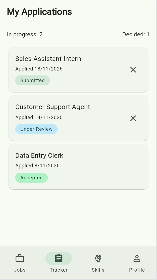
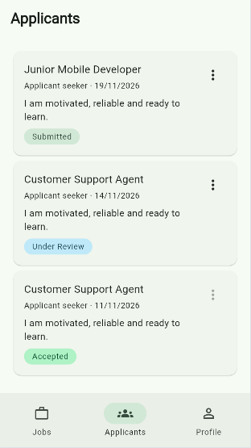
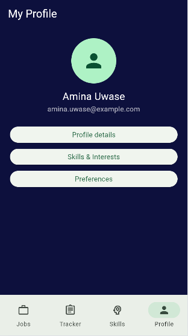

# Tujiajiri

Tujiajiri ("to create jobs for oneself") is a Flutter mobile app that connects young job seekers in Rwanda with **verified, entry-level opportunities**, matches listings to the **skills they can show**, and tells them **what happened to every application**.

It runs on Android (physical device or emulator) and uses Firebase Authentication and Cloud Firestore.

## Features

| Area | What a user can do |
|---|---|
| Jobs | Browse published jobs, search by keyword, skill or location, filter by employment type, see a **Verified employer** badge, open job details |
| Applications | Apply with a cover letter, track each application (Submitted → Under Review → Accepted / Rejected) live, withdraw an open application |
| Employers | Post, edit and delete their own jobs; review received applications and update their status from the **Applicants** tab |
| Profile & skills | Edit personal details, education, experience, skills and interests |
| Preferences | Theme, job sorting and notification settings, kept after the app restarts |
| Accounts | Register and log in with email/password or Google, verify the email, reset a password, log out, and stay logged in after a restart |

After sign-in, the app shows tabs for the user's role: **seekers** see Jobs · Tracker · Skills · Profile, and **employers/admins** see Jobs · Applicants · Profile.

## Requirements

| Tool | Version |
|---|---|
| Flutter | 3.47 (stable) or newer, with Dart 3.13+ |
| Android SDK | Installed through Android Studio |
| Device | An Android phone with USB debugging on, or an Android emulator |

> This is a mobile app. Web, Windows and Chrome builds are not supported.

## Setup

1. **Clone and install packages**

   ```bash
   git clone https://github.com/JesseN661/Tujiajiri.git
   cd Tujiajiri
   flutter pub get
   ```

2. **Firebase configuration.** The repository already contains the client configuration for the Firebase project `tujiajiri-80112`:
   `android/app/google-services.json` and `lib/firebase_options.dart`. These hold public client identifiers, not secrets; access to data is controlled by the security rules in `firestore.rules`.

3. **(For Google sign-in) register your SHA-1.** Google sign-in only works from machines whose signing key is registered in Firebase. Print your key's SHA-1:

   ```bash
   cd android
   ./gradlew signingReport
   ```

   Add the `SHA1` of the `debug` variant in **Firebase console → Project settings → Your apps → Android app → Add fingerprint**.

4. **Run on a device**

   ```bash
   flutter devices          # find your phone's id
   flutter run -d <device-id>
   ```

5. **Build a release APK**

   ```bash
   flutter build apk --release
   ```

   The APK is written to `build/app/outputs/flutter-apk/app-release.apk`. Release builds are currently signed with the debug key, so step 3 also covers the release APK.

## Firebase setup (project maintainers)

**Security rules.** The rules live in `firestore.rules`. To publish them (needs the Editor role on the project):

```bash
firebase deploy --only firestore:rules
```

**Roles.** A user's role is the `role` field of `users/{uid}`: `seeker` (default), `employer` or `admin`. Users cannot change their own role; set employer and admin roles in the Firebase console.

**Sample job.** Employers post jobs from the **Post a job** button on the Jobs tab. To add one by hand instead, use **Firestore → jobs → Add document** (jobs appear in the app when `status` is `published`):

```json
{
  "title": "Customer Support Agent",
  "employerId": "<the employer's uid>",
  "employerName": "Kigali Tech",
  "description": "Answer customer calls and chats.",
  "location": "Kigali",
  "requiredSkills": ["Communication", "Kinyarwanda", "English"],
  "employmentType": "Full-time",
  "experienceLevel": "Entry level",
  "isVerified": true,
  "status": "published"
}
```

The full data model, keys and relationships are in [docs/ERD.md](docs/ERD.md).

## Testing

```bash
flutter analyze                                  # static analysis (expects: No issues found)
dart format --set-exit-if-changed lib test       # formatting check
flutter test                                     # unit and widget tests
flutter test --coverage                          # writes coverage/lcov.info
flutter test integration_test -d <device-id>     # end-to-end tests on a phone or emulator
```

| Suite | Location | What it covers |
|---|---|---|
| Unit | `test/core`, `test/features/*` | Use cases, Cubits, repositories, error messages, roles |
| Widget | `test/core`, `test/features/*` | Pages, navigation shell (tabs, back button, landscape), snackbars |
| Integration | `integration_test/` | Apply → employer updates status → tracker updates live; duplicate applications; withdrawal |

The integration tests use the real repository, use cases, Cubits and pages, with an in-memory Firestore in place of the network, so they need no test accounts.

## Project structure

The code follows Clean Architecture: each feature is split into **data** (Firestore access), **domain** (entities, repository interfaces, use cases) and **presentation** (pages, widgets, Cubits). State is managed with **flutter_bloc** (Cubit).

```
lib/
├── main.dart                 # Firebase start-up and the sign-in gate
├── app/                      # App wiring: which tabs each role sees
├── core/                     # Shared code used by every feature
│   ├── error/                #   Failure base class, friendly error messages
│   ├── navigation/           #   Home shell (bottom bar / side rail) and its Cubit
│   ├── presentation/         #   Snackbar helpers
│   └── session/              #   User roles
└── features/
    ├── applications/         # Apply, tracker, employer review
    │   ├── data/             #   Firestore models and repository
    │   ├── domain/           #   Entities, repository interface, use cases
    │   └── presentation/     #   Cubits, pages, widgets
    ├── auth/                 # Registration and login
    ├── jobs/                 # Job listings, search, details, post and edit jobs
    └── profile/              # Onboarding, profile, skills, preferences
```

**Conventions**

- Business rules live in use cases or Cubits, never in widgets.
- Repositories are declared as interfaces in `domain/` and implemented in `data/`, so tests can swap in fakes.
- Expected errors extend `Failure` (`lib/core/error/failure.dart`); pages show any error with `context.showError(error)`, which turns Firebase codes into plain messages.

## Screenshots

| Jobs | Job details | Tracker | Applicants | Profile |
|---|---|---|---|---|
|  |  |  |  |  |

Screenshots show sample data on a 375 × 667 phone screen.
