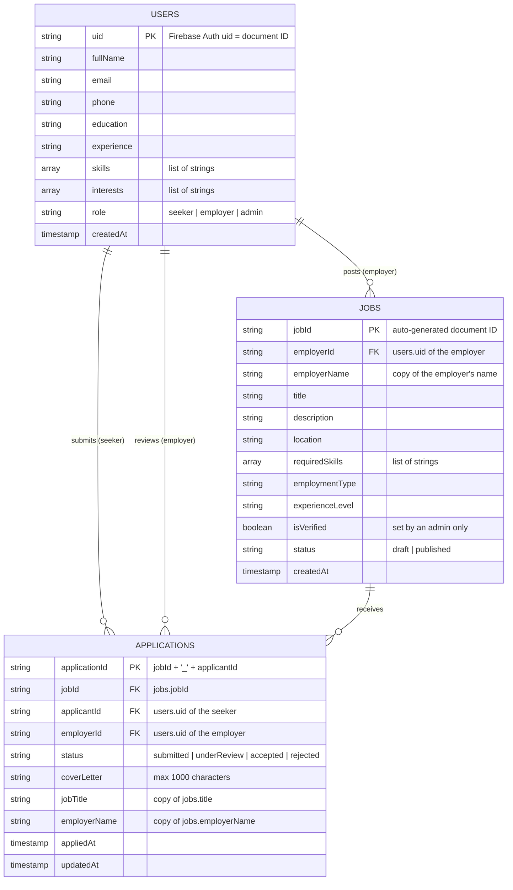

# Tujiajiri data model (ERD)

Tujiajiri stores its data in Cloud Firestore in three top-level collections: `users`, `jobs` and `applications`.
Firestore has no joins, so relationships are stored as document IDs (foreign keys) and resolved in the repositories.

## Collections

| Collection | Primary key | Foreign keys | Written by |
|---|---|---|---|
| `users` | `uid` (the Firebase Auth uid is the document ID) | none | The user (own profile); an admin (role changes) |
| `jobs` | `jobId` (auto ID) | `employerId` → `users` | Employers (own jobs); admins (verification) |
| `applications` | `applicationId` = `{jobId}_{applicantId}` | `jobId` → `jobs`, `applicantId` → `users`, `employerId` → `users` | Seekers (apply, withdraw); the job's employer (status) |

## Relationships

- One **employer** (a user with `role: employer`) posts many **jobs**: `jobs.employerId`.
- One **seeker** submits many **applications**: `applications.applicantId`.
- One **job** receives many **applications**: `applications.jobId`.
- Each application also stores the job's `employerId`, so an employer's applications can be listed with one equality query and the security rules can check who may change the status.

## Design decisions

- **One application per seeker per job.** The document ID `{jobId}_{applicantId}` makes a duplicate application impossible, and `SubmitApplication` checks it before writing.
- **Deliberate copies.** `applications.jobTitle` and `applications.employerName` copy fields from the job. An application keeps the details the seeker applied to, even if the job is later edited or deleted, and the tracker can list applications without one extra read per job. These are the only duplicated fields.
- **Verification belongs to an admin.** `jobs.isVerified` drives the "Verified employer" badge. Only an admin can set it (see `firestore.rules`), so an employer cannot mark its own listing as verified.
- **Roles.** `users.role` is `seeker` by default. A user can register as `seeker` or `employer` but cannot change their role afterwards; only an admin can.
- **Status history.** `appliedAt` and `updatedAt` record when an application was created and last changed, which supports the "status update within 7 days" measure from the research phase.
- **Indexes.** Every query is a single equality filter (`jobs.status`, `applications.applicantId`, `applications.employerId`) and results are sorted on the device, so no composite indexes are needed.

> **To confirm with the team:** the `users` fields above are the agreed target for Tasks 2 and 4. The profile screen currently saves to SharedPreferences and skills are held in memory; both must move to `users/{uid}` through `ProfileRepository` for this ERD to match the database.
